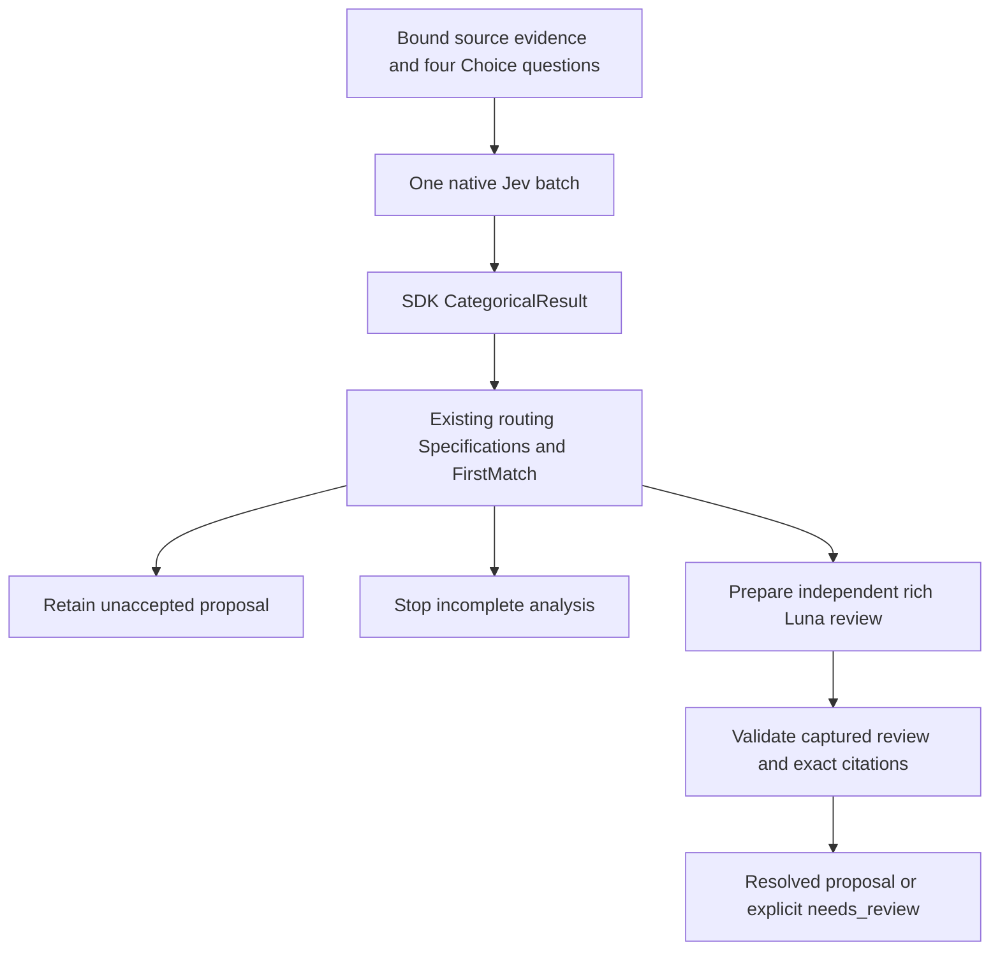

# Categorical SDK bridge to semantic review

Date: 2026-10-18. Consumer: `evals/jev-classification/categorical_review_bridge_v1`.
Requires the current Jev4Mellea 0.9.0 evaluation lock. PR #86 was reviewed first:
all eight current-head CI checks passed, GraphQL review threads were empty, and
author self-review found no blocking issue. This is not an independent review.

## Integration



`NativeBatchCategoricalProvider` borrows an existing SDK `TypeSafeProvider`.
It calls `system_one` once with all four questions, then uses public
`project_choice_results` to return the same `CategoricalResult` abstraction as
ordinary Responses classification. The wrapper neither closes the provider nor
adds retries, protocol fallback, model selection or acceptance thresholds.
Native probabilities/confidence remain separate original evidence; ordinary
results receive no invented distribution. Usage comes from the one batch result
and is not summed across its four answers.

The SDK's new `TypeSafeCategoricalProvider` and `OpenAICategoricalProvider` accept
one question per task and reject a batch before dispatch. Applying each axis
separately would turn one request into four and change budget/execution semantics.
The consumer therefore retains the public native batching API and projects its
already-collected results. It does not modify the SDK or silently split requests.

Rich review is a distinct capability. A label-only `CategoricalResult` cannot
provide quotations, missing evidence or rationale. The bridge prepares the
existing strict `structured_semantic_review_v1` request only when the existing
routing policy selects `ordinary_review`; its inspector handles captured rich
responses. No previous System One or Sol labels are added to the review request.

## Public seams and authority

| API | Responsibility |
| --- | --- |
| `bind(context, state_json=..., questions_json=...)` | Require a `not_run` context; verify source/configuration digests, four-axis catalog, architectural goal, target identity and exact source fragments. Preserve missing premises and checked caller claims. |
| `NativeBatchCategoricalProvider(provider).classify(task)` | Potentially billable SDK call, explicitly invoked and owned by the caller. One logical batch; provider lifetime, authorization, transport capture and global budgets belong to that caller. |
| `categorical_plan(bound, result, response_sha256=...)` | Convert a caller-bound categorical result into the existing typed routing context; snapshot metadata and prepare an optional independent review. |
| `replay_jev_capture(bound, raw, ...)` | Offline parser integration using an in-memory SDK HTTP transport. Check exact outgoing semantic task/model; reject duplicate JSON, oversized captures and invalid metadata without fallback. |
| `plan.review_request()` | Return a detached rich-review request, or None when review is not selected. Never dispatch. |
| `plan.inspect_review(...)` | Reuse the existing rich-review inspector, including explicit not-run/failure/unresolved outcomes. Reject an unselected review. |

`categorical_plan` receives the response digest and provider identity as caller
premises: categorical SDK metadata alone does not authenticate a response or bind
it to source code. Its direct caller must establish that the result and capture
belong to the bound task. The replay seam exercises that semantic task through
the actual SDK and captured body, but still does not attest remote execution.
All `hosted_requests=0` counters describe the bridge/replay operations, not the
earlier execution that produced an input capture. Request IDs/usage are reported
metadata. Unknown cost remains unknown. No source locator is promoted into
semantic correctness; accepted facts, S/U and write authority remain unchanged.

`CascadePlan` checks its internal binding at construction and at every public
consumer. Its capture snapshot must match the typed assessment's status,
response digest, labels and valid model metadata. The presence of a prepared
review must match the route, and that review's complete original context must
equal the plan's context. Request identity alone is insufficient: independent
review input intentionally omits the first-stage labels, but material-disagreement
resolution still depends on those labels. A mixed plan is rejected before
rendering, request access or review inspection. The same independent review
response may still be reused by coherent plans; each resolves it against its
own preserved first-stage assessment.

The SDK's native probability-mass check is independent of the older native
capture parser's model-specific allowance. This bridge does not relax the SDK,
normalize its numbers or reinterpret its protocol rejection as semantic doubt:
SDK rejection becomes incomplete analysis, with no ordinary-model fallback.
The eight captured Jev cases used here pass both contracts.

## Offline replay and existing Luna receipt

From `evals/jev-classification`, using the current repository environment:

```bash
../../.venv/bin/python -W error -m unittest -v test_categorical_review_bridge_v1.py
../../.venv/bin/python replay_categorical_review_v1.py
../../.venv/bin/python replay_categorical_review_v1.py --reuse-saved-review
```

The replay verifies the pinned native receipt, producers and file inventory,
then passes all eight Jev responses through the 0.9.0 SDK without credentials or
network. It retains **seven proposals and selects one ordinary review**.
This is compatibility/routing evidence, not a new model-quality comparison.
The older benchmark producers, labels, receipts and environments are unchanged.
The SDK native wire representation may differ from the older native runner;
the replay checks semantic task equality, not historical native wire equality.

`--reuse-saved-review` explicitly selects the one pinned historical Luna receipt.
It verifies its complete artifact inventory and producer closure with the
existing verifier, then requires the complete review request digest to match.
The R04/baseline request is byte-identical to the earlier live pilot. Its saved
answer remains `policy / limited`, with an exact source quotation and final
`needs_review`. No ambiguity is cleared by connecting the adapters. A different
task is rejected rather than matched approximately or silently re-executed.

There is no new live runner, recursive escalation or GitHub comment publisher
in this change. Further inference still requires an approved bounded run. The
next execution layer can use the public adapter while retaining the existing
durable single-spend reservation and transport-receipt rules.

The active [historical SpecGraph PR714 packet preparation v2](../evals/jev-classification/runs/2026-10-19-specgraph-pr714-preparation-v2/README.md)
contains four exact source-bound decisions, their intent/document/test context,
and `not_run` bindings. Current SDK and Rust CLI checks are offline only;
there is no new classifier result, independent reference or live authorization.
V2 retains surrounding context without repeating selected source intervals.
The frozen v1 overlap and its correction are documented in the v2 preparation.

The separately authorized [PR714 live route pilot](../evals/jev-classification/runs/2026-10-19-specgraph-pr714-live-v1/README.md)
now records four Jev batches in 9.706 seconds, four retained proposals and no
selected ordinary reviews. It preserves low native confidence values that the
categorical consistency router does not use; this is an explicit routing
limitation, not an accuracy claim or a reason to accept those proposals.

## Verification

Local Python 3.11 / SDK 0.9.0 validation passed **115 tests**: the 15 new bridge
tests and 100 existing compatibility/policy/routing/review/transport tests.
They cover one-batch cardinality, borrowed lifetime, complete native evidence,
ordinary categorical results without invented probabilities, stale source/tasks,
invalid labels/model/HTTP/JSON, mutated distributions, preserved missing premises,
exact saved-review reuse, rejection of a changed task and mixed-plan contexts.
The replay entry point
also completed with seven retained, one reviewed, zero new hosted requests and
the saved review still unresolved. Workflow YAML parsing and whitespace checks
passed. The dedicated current-SDK CI job includes the bridge suite.
