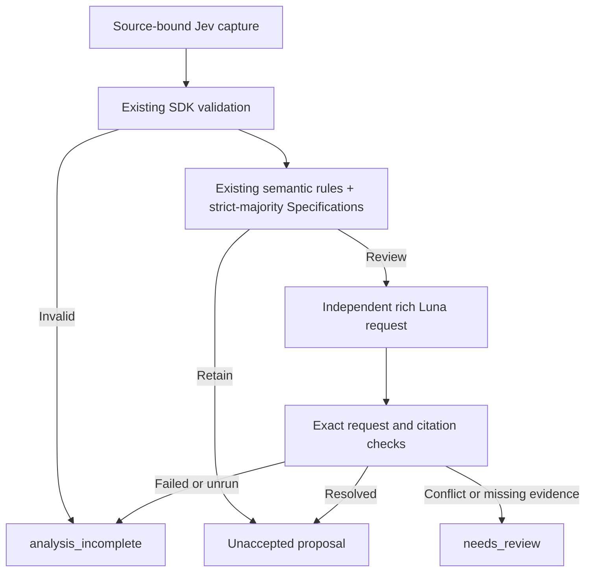

# Enforced native uncertainty cascade

Status: **connected in the new v2 evaluation runner; verified offline**.
Adapter: `native_review_cascade_v1`; entry point: `specgraph_pr714_live_v2.py`.
This is the Python evaluation runtime, not a change to the Rust scanner CLI.



The [uncertainty policy](native-uncertainty-routing-v1.md) is unchanged. Its original
shadow consumer remains historical evidence; the new adapter enforces the same
predicate when deciding whether to prepare and dispatch a review. The original
baseline route is reported separately from the enforced route.

## Why a new adapter is required

The frozen rich-review v1 constructor/inspector accepts only reviews selected by
the original categorical router. An additional majority signal cannot reach it
by replacing the caller alone. Fabricating an `unknown` answer or adding a false
evidence gap would corrupt original assessment identity and disagreement handling.

The new adapter validates the real bound capture, applies the new selection and
builds the **same independent task/wire schema** from the unchanged original
context. Resolution reuses the existing citation, coverage, material-disagreement,
evidence and unresolved-routing Specifications. Version-specific orchestration
and inspection entry points leave frozen producers and old receipts valid.

`NativeCascadePlan` stores only the bound task, raw native body and HTTP status.
Every public consumer reconstructs its derived context and route. A caller cannot
replace labels or a prepared review while retaining an unrelated valid request
digest. The review input includes the original source/intent/questions and real
missing evidence; it excludes Jev labels, native masses and numeric confidence.

## Public API

```python
from native_review_cascade_v1 import plan_capture

plan = plan_capture(bound_task, captured_jev_bytes, http_status=200)
report = plan.report()  # original_route and enforced routing are separate
request = plan.review_request()  # None unless review is selected; no dispatch
# Application/runner owns explicit authorization, request freezing and transport.
inspection = plan.inspect_review(
    captured_luna_bytes,
    captured_request_sha256=report["review_request_sha256"],
    execution_status="completed",
)
```

Calling `inspect_review` on an unselected route raises. A missing, failed,
truncated, refused, invalid or wrong-request review remains visibly incomplete.
Valid but materially disagreeing or insufficiently supported review remains
`needs_review`. No recursive escalation or automatic fact acceptance occurs.

The v2 runner consumes this API for native response selection, exact conditional
request matching, dispatch, reporting and replay. Its baseline and new-route
traces remain visible beside review findings and missing evidence. It retains
the prior transport bounds, fresh single-spend preparation and explicit `--live`
plus a separate approval artifact bound to the exact preparation, request
manifest and budget. The runner validates supplied approval, never grants it.
See the [runtime contract](../evals/jev-classification/native-review-cascade-runtime-v1.md).

## Evidence and remaining work

Tests cover the four captured Jev fixtures selecting three requests, exact
independent-wire equality, preservation of real labels/gaps, strict request/task
binding, valid resolution versus material disagreement, missing/invalid citations,
unselected-route rejection, incomplete outcomes and the full bounded runner with
synthetic transport. No new API request or live Luna outcome is claimed.

The old PR714 live result and shadow comparison can still be replayed unchanged
in their qualified local environment. A new live run is a separate, explicitly
budgeted action; the previously spent reservation is not reused. Classification
accuracy and actual benefit of the added reviews remain unmeasured.
