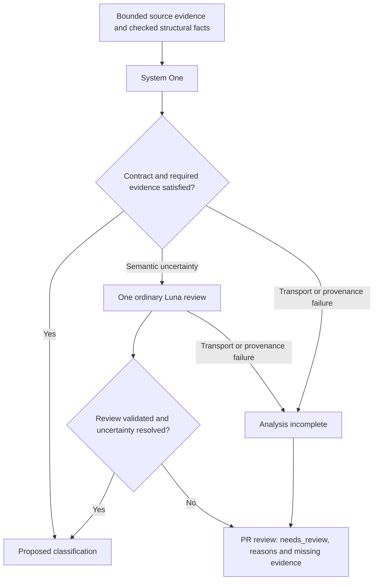

# Semantic review cascade v1

Date: 2026-10-18. Status: offline first-stage routing implemented;
the ordinary-review adapter and PR publisher remain planned.

## Purpose

Use inexpensive, fast System One classification first. Give an unresolved
semantic decision one ordinary-Luna review. If uncertainty remains, publish it
explicitly as `needs_review`. These are semantic suggestions, not permission to
modify the accepted registry, S/U, source code or existing merge gates.

The [current provider comparison](../evals/jev-classification/provider-comparison-2026-10-18.md)
supports Jev as a provisional first stage and `gpt-6-luna` / low through
Jev4Mellea Responses as the reviewer. Backend selection is configurable; native
Luna Decision is a separate backend from ordinary Luna. No additional provider
fan-out or reasoning-effort increase is implicit.



## Routing rules and precedence

Bind each assessment to repository, revision, exact decision span, evidence
digest, rubric and category versions, requested action, and required axes.
Evaluate the following in order; record every applicable reason even when an
earlier row determines the route.

| Condition | Route and reason |
| --- | --- |
| Source identity/digest is invalid, response is missing/invalid, or transport fails | Mark `analysis_incomplete`; report operational cause separately. Do not turn failure into a semantic label or silently invoke another model. |
| A required definition or intent/proposal/spec document is known to be missing | Select `ordinary_review`, reason `missing_premises`, status `needs_review` (`review_status=not_run` until execution). Preserve the gap through any completed review; it cannot resolve by guessing or omission. An earlier operational failure instead selects `stop_incomplete` / `analysis_incomplete`, while retaining this semantic reason. |
| Existing SpecificationCore consistency rules reject the tuple | Ordinary review, `inconsistent_answers`. Preserve all original labels. |
| `concern_kind=unknown`, or evidence support is `insufficient` or `limited` | Ordinary review, `unresolved_role` and/or `insufficient_evidence`. |
| A required axis is unknown, or supplied trusted facts contradict a material claim | Ordinary review, `required_axis_unknown` or `evidence_conflict`. |
| A future calibrated uncertainty rule fires | Ordinary review, `calibrated_uncertainty`, recording calibration/configuration version. No numeric threshold is enabled in v1. |
| Otherwise | Retain a proposed classification, not an accepted fact or proof. |

Unknown owner/tool is not globally an escalation trigger. For a role assessment,
require a known role and supported evidence; owner/tool may remain unknown.
For a proposal to reuse a particular Specification or exclude a rule as already
owned, require that ownership and exact decision binding. For a proposal to
delegate to a formatter/linter, require an identified tool/rule and its binding.
Do not turn unknown ownership into a recommendation to create a new rule when
that recommendation assumes no existing owner.

The existing `RoleSupportConsistentSpec` and
`ResponsibilitiesCompatibleSpec` remain unchanged. Implement routing and
resolution as named SpecificationCore rules in separate modules, with traces;
do not replace the shared rules with duplicated procedural predicates.

## Ordinary review and resolution

1. Give Luna the same bounded evidence, architectural purpose, category catalog
   and semantic guidance. First obtain its independent assessment without the
   System One labels or Sol/reference labels. Compare the results afterwards.
2. Request a strict structured review envelope containing labels, evidence
   references with source quotations, missing evidence, and a short rationale.
   This is a new reviewer contract: the current label-only categorical result
   does not already supply those fields. Never synthesize native probabilities
   for ordinary models, and never equate model certainty with evidence support.
3. Validate response identity/schema, enum values, exact quote/span membership,
   required axes and the shared consistency rules. Source-quote existence is a
   structural check; it does not prove the model's semantic interpretation.
4. Clear a support-only inconsistency when the known role is unchanged, Luna
   supplies supported evidence, and all required validations pass. A material
   disagreement about role, ownership or tool responsibility remains
   `needs_review` unless checked structural facts settle that specific claim.
   Do not simply overwrite the first answer because the second model is larger.
5. Keep missing premises, remaining contradictions, invalid citations, refusal,
   truncation, budget exhaustion or absent review visible. An unavailable review
   is `not_run`/`failed`, never `resolved` or a clean scan. No recursive escalation
   or silent prompt/context expansion follows.

At most one logical ordinary review per candidate/evidence/configuration binding.
Reuse an exact matching receipt where available. Before hosted execution, freeze
the request/token/time budgets and approval scope. Keep transport retry policy
separate, bounded and explicit; ambiguous dispatches must not be silently retried.
This document authorizes no new paid run or retry policy.

## PR review output

Show counts of examined, proposed, escalated, resolved, unresolved, failed and
not-run decisions. Display per-request latency scopes and usage buckets; show
cost as unknown unless request-attributable billing or a labeled rate estimate
exists. Publish one idempotently updated report bound to the PR head revision.
Follow the repository's trusted workflow/credential boundary; a PR cannot grant
itself authority to invoke paid inference or publish an authoritative clean bill.

Every unresolved item names the exact code site, evidence revision/digest,
original System One labels, Luna review status/labels, routing rule/reason IDs,
remaining disagreement or missing premise, and the next required evidence or
human decision. Link both receipts and model/prompt/configuration identities.
Never fabricate an explanation for a native provider that only returned scores.

Example of a synthetic unresolved report, not an observed new model result:

> **Needs review — policy or mechanics remains unresolved.**
> Site: `path/to/module.py:42`, revision `<head>`, exact decision `<id>`.
> System One: `unknown / insufficient`. Luna: `policy / limited`.
> Missing: the intent/specification defining whether this branch controls
> publication or only renders a diagnostic. Supply that contract or adjudicate
> explicitly. No automatic exclusion or accepted S/U change was made.

Use informational mode first. Uncertainty is not a fabricated duplicate violation
or an implicit new merge blocker; existing authoritative gates keep their scope.
It must also not be rendered as zero findings or a complete successful analysis.

## Delivery and acceptance

1. **Offline routing:** typed context, named specifications, deterministic
   precedence, traces and replay. The current Jev sample selects one of eight
   views for review; owner/tool unknown alone selects none of the other seven.
2. **Review adapter:** versioned structured review and evidence validation,
   first with synthetic Responses payloads. Test unresolved role, limited
   evidence, material disagreement, missing required owner/tool, bad citations,
   refusal, invalid schema, stale evidence, timeout and exhausted budgets.
3. **PR report:** render resolved/unresolved/failed/not-run distinctly, verify
   head binding and idempotency, then use an explicitly bounded live pilot.
4. **Qualification:** independently labeled held-out families, same-input
   repeats and deliberate insufficient-context controls. Measure escalation,
   supported resolution, false resolution, missed escalation, latency, expense
   and human workload. Audit a separately budgeted sample of coherent first-stage
   proposals: a self-consistent wrong answer may never trigger escalation.

Acceptance requires retaining every unresolved or incomplete case in the report,
zero invalid-citation resolutions in deterministic regression cases, unchanged
accepted facts/S/U, and no inference during offline checks. Declare live quality
thresholds and sample size before qualification. A retrospective 32/32 selection
on four development targets does not qualify the cascade.

## Implemented offline routing

`evals/jev-classification/semantic_review_routing_v1` implements the first delivery
step. `evaluate(RoutingContext)` returns all applicable findings and a trace from
named SpecificationCore rules, then selects one route with `FirstMatch`:

| Route | Status | Meaning |
| --- | --- | --- |
| `retain_proposal` | `proposed_not_accepted` | Keep the source-bound classification suggestion; no review is currently required. |
| `ordinary_review` | `needs_review` | Select one future ordinary review; its current status is `not_run`. |
| `stop_incomplete` | `analysis_incomplete` | A response, model/provider identity, decision binding or checked-claim binding is invalid/missing. No semantic fallback is scheduled. |

Operational failure has precedence, but semantic reasons are retained too.
The trace records the shared `RoleSupportConsistentSpec` and
`ResponsibilitiesCompatibleSpec`, every routing observation, and skipped later
`FirstMatch` branches. There is no numeric confidence threshold, network call,
review-resolution claim, fact acceptance or S/U mutation.

The immutable binding includes repository/revision, path and line span, decision
ID, evidence digest, rubric/category versions, prompt/configuration digest,
requested action and additional required axes. Provider/model identities are
also checked against the caller's expectation. Checked claims require their
binding digest and a reviewed/source-bound locator; development hypotheses
cannot satisfy those claims. These are caller-established premises, not proof
that the router verified source contents or authenticated a remote response.
The future adapter must establish them independently of model-generated labels.

For `assess_role`, unknown owner/tool does not escalate. `reuse_specification`
and `exclude_owned` additionally need a known owner plus an exact-decision
claim. `delegate_tool` needs a known tool responsibility and a tool-rule claim.
`create_specification` needs checked scoped ownership absence; an unknown label
never becomes absence. A caller can require additional axes. The requested
action sets evidence requirements; retaining a classification does not approve
that action. Recommendation semantics remain with the recommendation policy.

Run the read-only replay in the repository Python environment:

```bash
cd evals/jev-classification
../../.venv/bin/python -W error -m unittest -v test_semantic_review_routing_v1.py
../../.venv/bin/python replay_semantic_review_routing_v1.py
```

Replay verifies the pinned native result receipt, complete artifact inventory,
producer source hashes, request/response identities and captured source excerpt.
It parses captured responses with the existing native adapter; no Sol labels
are routing inputs. The frozen Jev cohort selects R04/baseline only: seven
retained, one review. Native Luna Decision selects seven reviews and retains
one. No reviewer is invoked, and no item is reported as resolved. The suite
also checks 144 combinations of role/support/owner/tool/operational state,
action-specific evidence, stale bindings, missing premises, immutability and
tampered observations. CI runs the policy suite and offline replay.
The existing `test_recommendation_policy_v1` CI entry point composes the routing
suite through `unittest.load_tests`; workflow files are unchanged. General test
discovery finds the routing module directly without adding a duplicate suite.
